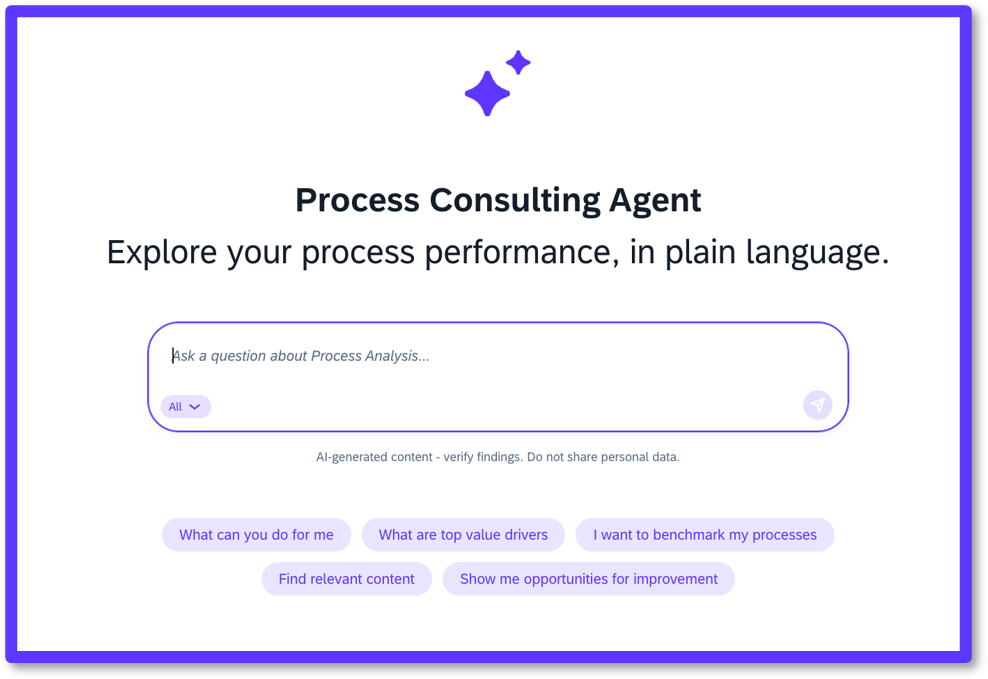
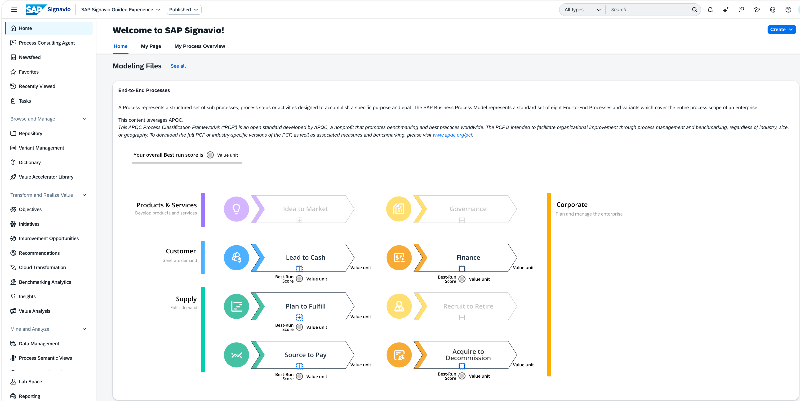
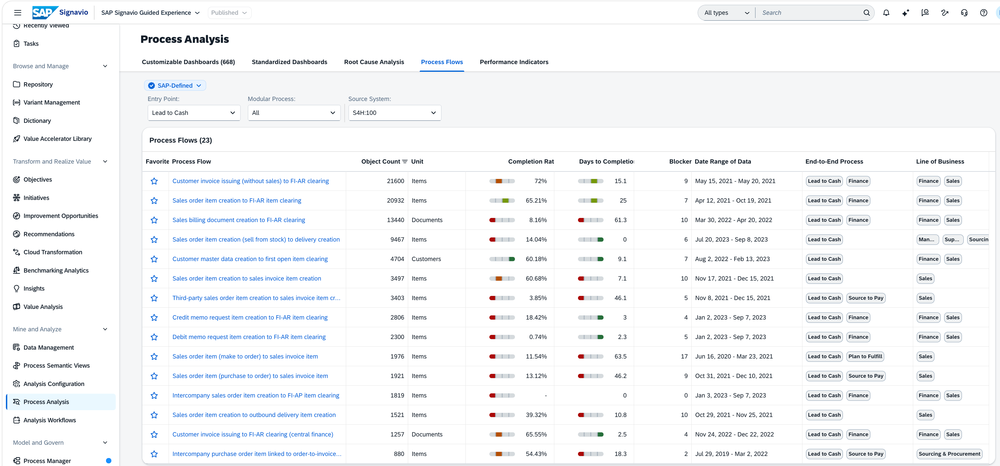
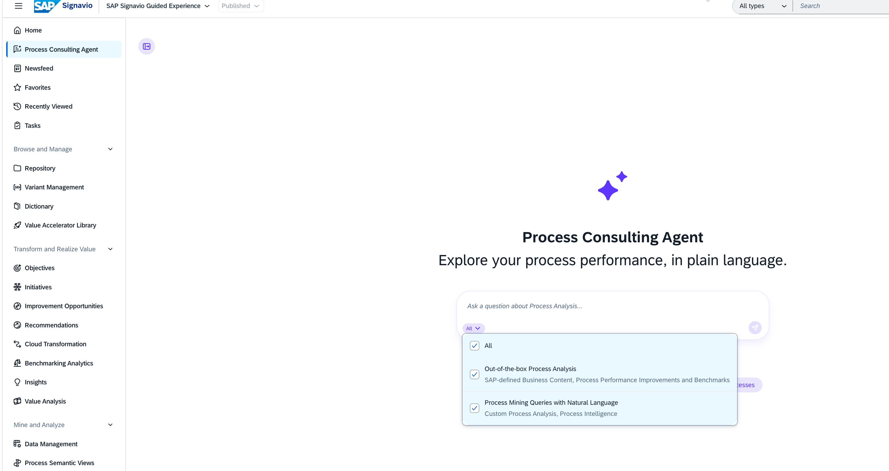
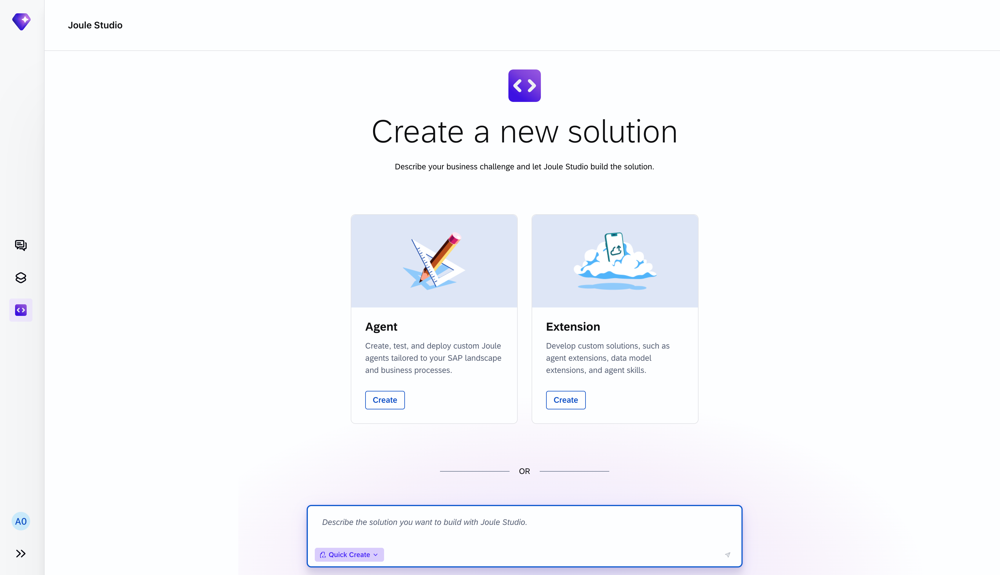
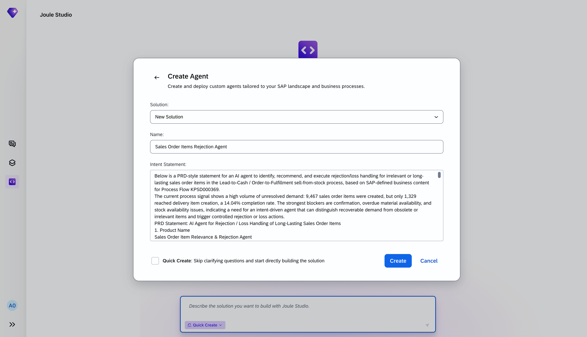
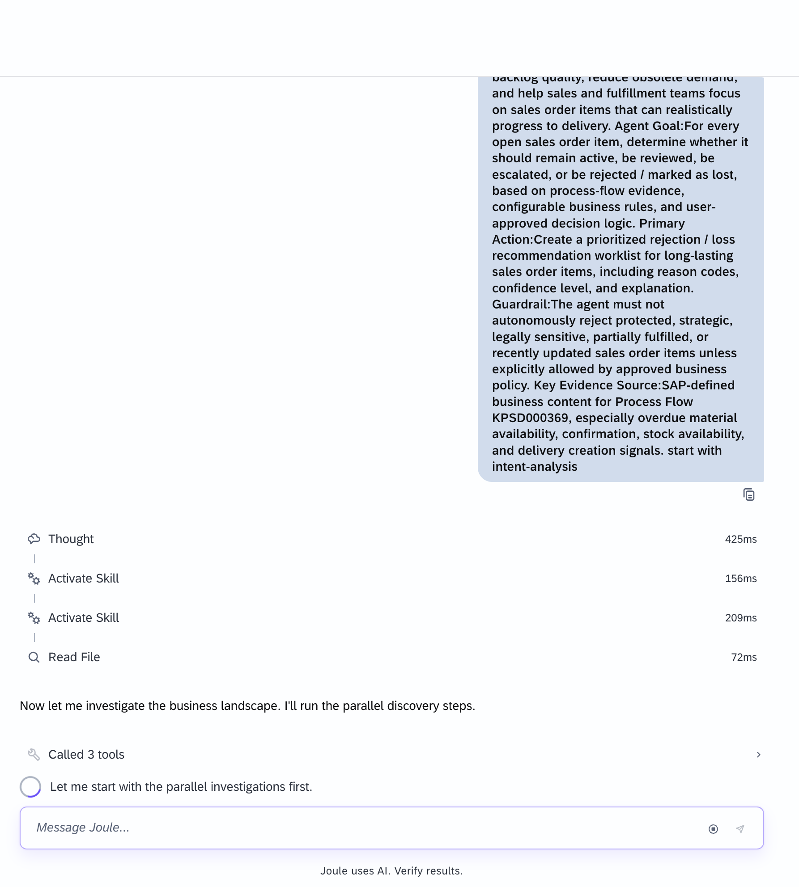

# AD163 - Discover insights with Process Consulting Agent

  

## Description

This repository contains the material for the SAP TechEd 2026 session called **AD163 - Discover insights with Process Consulting Agent**.

## Overview

This session puts you in the shoes of a supply chain analyst at **Berlin Supplies HQ** and shows how the **SAP Signavio Process Consulting Agent** turns a vague customer complaint into concrete, data-driven answers — without calling 100 plant managers one by one.

### Setting the scene

> 🚨 **Monday morning. 8:47 AM. Third coffee not yet consumed.**

You're settling into your chair at Berlin Supplies HQ, mentally preparing for another week of keeping the world's supply chain from completely falling apart.

Your phone rings.

It's **Klaus-Dieter**, Head of Procurement at **Späti Solutions GmbH** — your company's biggest client in the convenience distribution sector. Späti Solutions supplies half of Berlin's beloved corner stores, and if they run out of Club Mate and Kokosnuss chips, they will run into problems.

Klaus-Dieter is not happy.

> "Listen, I don't know what's going on over there, but our shelves are getting emptier by the day. Deliveries are late. Again. I'm not saying it's a disaster… but my warehouse manager already cried this week. Twice!"

You grab a pen and try to take notes.

> "Which orders exactly, Klaus-Dieter?"
> "All of them."
> "All… all of them?"
> "Look, I'm a busy man. I trust you'll figure it out."

He hangs up.

You stare at your screen.

Berlin Supplies operates **100+ production plants across 17 countries**. Orders flow in from 6 continents. You have no order number, no plant reference, no date range, no product category. What you do have is a vague complaint and a very real Monday morning.

### Your mission

Lucky for you, you have access to **SAP Signavio Process Intelligence**.

Instead of calling 100 plant managers one by one (please don't), you're going to let the data do the talking. Your goal:

- **Find out where late deliveries are actually happening** — which plants, which regions, which suppliers?
- **Understand the root cause** — is it a process deviation, or are supplies being delivered late? Which step is causing the delay?
- **Come back to Klaus-Dieter with answers** — and maybe save his warehouse manager from a third crying episode.

Let's dig in. The data doesn't lie.

## Requirements

To follow the exercises in this repository you need access to the **SAP Signavio Transformation Suite**.

- **Log in via:** https://editor.signavio.com/p/hub/home?t=6199d8fcf88f4a53afb55bc730f931f2 (hint: use an incognito tab)
- **Credentials:** your login will be shared with you at the event.

## Exercises

### Exercise 1 - Find where the delays originate

Start with the burning question: where do Klaus-Dieter's delivery delays actually come from?

Log on to the **SAP Signavio Transformation Suite**.

  

Navigate to **Process Analysis → Process Flows** and take a look at all **Lead to Cash** process flows.

> **Question:** What is the process flow with the highest object count, and how long is its lead time?

  

> 💡 **Hint:** "Days to complete" can be considered as the total lead time. More details on the lead time can be investigated by clicking on each process flow and looking at the lead time between process steps.

### Exercise 2 - Investigate with the Process Consulting Agent

Here's the challenge: Berlin Supplies isn't one plant, it's over 100 — spread across 17 countries, running on multiple ERP instances. Doing this manually means a lot of work.

To speed things up, you ask the exact same questions — this time to SAP Signavio's **Process Consulting Agent**.

  

#### Exercise 2.1 - Analyze late deliveries

> **Prompt:** Analyze late deliveries in Lead-to-Cash for sell-from-stock orders using SAP-defined business content and process performance insights. Show top drivers by plant and sales order.

> 💡 **Hint:** With the drop-down menu in the Process Consulting Agent you can preselect whether you want to analyze SAP-defined content or Process Mining queries overall.

The Process Consulting Agent gives you a list of the plants that have delivered late and have long lead times for Sales Order Creation to Delivery.

> **Prompt:** Show plants with the most late deliveries and longest lead times from sales order item to delivery creation. Please add benchmarks if available.

> 💡 **Hint:** You can also ask the Process Consulting Agent which process step took the longest time.

#### Exercise 2.2 - Trace the root cause to your suppliers

You want to understand the root cause of the late deliveries. Your assumption is that some of your suppliers have also delivered late in the last couple of months, as demand for Club Mate has increased worldwide due to a viral social media campaign.

> **Prompt:** Check the event logs for Plug and Gain - source-to-pay in SAP ERP and list suppliers that are delivering late.

#### Exercise 2.3 - Get correction and improvement recommendations

Now you ask for potential corrections and improvement opportunities you could execute.

> **Prompt:** Recommend top 10 correction recommendations and improvement opportunities to improve on-time delivery in sell from stock.

#### Exercise 2.4 - Report back to Klaus-Dieter

You want to share your findings and write a follow-up mail to Klaus-Dieter.

> **Prompt:** Generate a summary of root causes and the actions you want to take. Bring it into a format that can be used for an external mail to be sent to Klaus-Dieter from Späti Solutions to give him feedback on his complaint.

> 💡 **Hint:** Feel free to try out different prompts. The more context you add (e.g. "I am working in Order Management", "My customer has requested an update on deliveries", etc.) the better the output.

#### Exercise 2.5 - Launch a Transformation Manager initiative

The Process Consulting Agent is now suggesting an action plan. Part of the action plan is to check if material exists under different material numbers in other plants with stock available. You ask the Process Consulting Agent to start an initiative and work on improving it in Transformation Manager.

> **Prompt:** Draft a Transformation Manager initiative that tracks the activity of material number harmonization.

### Exercise 3 (Optional) - Build your own agent with Joule Studio

After analyzing processes, variants and corrections, you would like to test **Joule Studio** to build your own agent.

First, ask the Process Consulting Agent to help you define the agent:

> **First prompt:** Recommend which of the above activities are most relevant to get automated by an AI agent.

> **Second prompt:** Define an AI agent to reject or lose irrelevant and long-lasting sales order items as a PRD statement for intent-based development.

Then build the agent in Joule Studio:

1. Open a new tab and open Joule Studio: https://747391938.eu10.sapdas.cloud.sap/new/
   Log in with `AD163-0**` (your user number); the password will be shared with you.
2. Open Joule Studio (`<>`) and click **Create** for the agent.

   

     
   

3. Open your last conversation in the Process Consulting Agent and click the **copy** icon for your PRD statement.
4. Give your agent a name and use **Ctrl + V** to paste your description into the **Intent Statement** field.
5. For the purpose of this demo, check the box **Quick Create**.

   

     
   

6. Click **Generate Requirements**, confirm the answers/suggestions, and follow the flow of Joule Studio.
   ⏳ This step and the ones that follow can take quite some time.

   

     
   

7. Open and review the product requirements document.

**Next steps to explore on your own:**

- View / generate specifications.
- Create the solution and test it within Joule Studio.

## Contributing
Please read the [CONTRIBUTING.md](./CONTRIBUTING.md) to understand the contribution guidelines.

## Code of Conduct
Please read the [SAP Open Source Code of Conduct](https://github.com/SAP-samples/.github/blob/main/CODE_OF_CONDUCT.md).

## How to obtain support

Support for the content in this repository is available during the actual time of the online session for which this content has been designed. Otherwise, you may request support via the [Issues](../../issues) tab.

## License
Copyright 2026 SAP SE or an SAP affiliate company and teched2026-AD163 contributors. Please see our [LICENSE](LICENSE) for copyright and license information. Detailed information including third-party components and their licensing/copyright information is available [via the REUSE tool](https://api.reuse.software/info/github.com/SAP-samples/teched2026-AD163).
